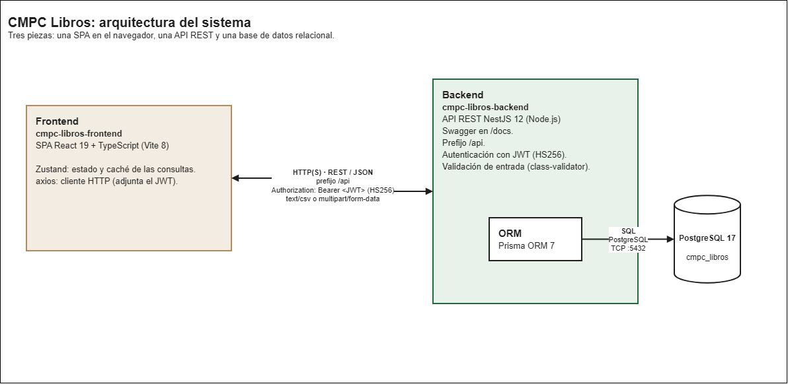
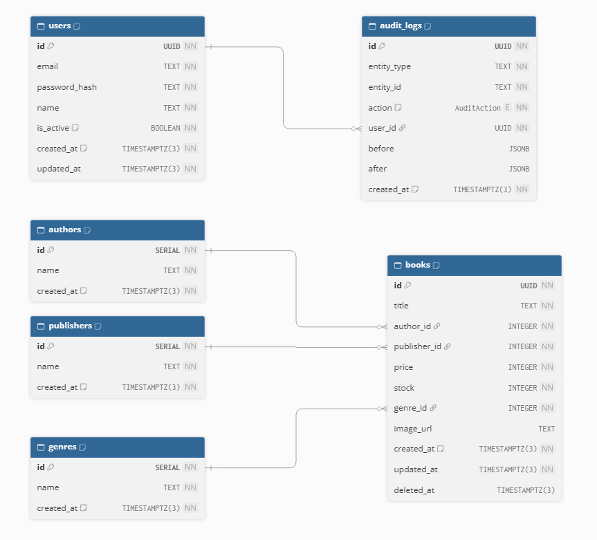

# CMPC Libros: stack completo con Docker

Levanta **todo el sistema** (base de datos, API y aplicación web) en tu máquina con un solo comando. Este repositorio sólo contiene la orquestación; el código vive en dos repositorios que deben estar en carpetas hermanas:

```
prueba-cmpc-libro/
├── docker-compose.yml        ← este repositorio
├── .env.example
├── cmpc-libros-backend/      API NestJS + Prisma          → ver su README
└── cmpc-libros-frontend/     aplicación web React + Vite  → ver su README
```

Cada proyecto tiene su propio `docker-compose.yml` y se puede levantar solo (ver la sección *Con Docker* de su README). El de esta carpeta no define servicios: los **incluye** (`include:`) y les pasa el `.env` de esta carpeta, así la configuración vive en un solo sitio.

## Requisitos

- **Docker Desktop** (o Docker Engine) con **Docker Compose v2.20+**.
- Internet la primera vez (imágenes base y dependencias).
- Puertos libres: `3000` (API) y `8080` (web). Se cambian en el `.env`.

## Inicio rápido

```bash
cp .env.example .env            # trae valores que sirven para probar en local
docker compose up --build       # la primera vez tarda unos minutos
```

| Qué | Dónde |
|---|---|
| Aplicación web | http://localhost:8080 |
| API | http://localhost:3000/api |
| Swagger | http://localhost:3000/docs |

Usuario de prueba: `admin@cmpc.cl` / `Admin1234!`. La base arranca con 10 géneros y 40 libros de ejemplo.

## Configuración (`.env`)

Sólo `JWT_SECRET` es obligatoria. Estas variables son propias del stack:

| Variable | Por defecto | Descripción |
|---|---|---|
| `WEB_PORT` / `API_PORT` | `8080` / `3000` | Puertos en tu máquina |
| `PUBLIC_API_URL` | `http://localhost:${API_PORT}` | URL de la API tal como la ve el navegador. **Se fija al compilar la web**: si la cambias, `docker compose up --build` |
| `CORS_ORIGINS` | `http://localhost:${WEB_PORT},http://localhost:5173` | Orígenes desde los que la API acepta peticiones con la sesión |
| `POSTGRES_USER` / `POSTGRES_PASSWORD` / `POSTGRES_DB` | `cmpc` / `cmpc` / `cmpc_libros` | Credenciales y nombre de la base |

Las demás (`JWT_SECRET`, `JWT_EXPIRES_IN`, `COOKIE_SECURE`, `LOGIN_MAX_ATTEMPTS`, `LOGIN_LOCK_SECONDS`, `LOG_LEVEL`, `UPLOAD_MAX_BYTES`, `SEED_USER_*`) configuran la API y se explican en la [tabla de configuración del backend](cmpc-libros-backend/README.md#2-configuración).

Al cambiar `WEB_PORT` o `API_PORT`, el CORS y la URL de la API se ajustan solos; reconstruye con `--build`.

## Arquitectura



## Base de datos


## Comandos útiles

```bash
docker compose up -d --build            # en segundo plano
docker compose ps                       # estado y salud de cada servicio
docker compose logs -f api              # logs de la API (JSON, uno por línea; o web, postgres, migrate)
docker compose exec postgres psql -U cmpc -d cmpc_libros     # consola SQL
docker compose down                     # quita los contenedores y conserva los datos
docker compose down -v                  # ... y BORRA los datos (base y portadas)
```

## Problemas frecuentes

- **`GetFileAttributesEx …\.env` o `env file … not found`:** falta el `.env` de esta carpeta: `cp .env.example .env`.
- **`required variable JWT_SECRET is missing`:** el `.env` no define `JWT_SECRET`.
- **`port is already allocated`:** otro programa usa el 3000 o el 8080 (por ejemplo, la API en modo desarrollo). Detenlo o cambia `API_PORT` / `WEB_PORT`.
- **La web carga pero no inicia sesión:** abre la web y la API con el mismo nombre de host (`localhost` en ambos, no `localhost` y `127.0.0.1`) y revisa que `PUBLIC_API_URL` y `CORS_ORIGINS` coincidan con esas direcciones; después, `--build`.
- **Empezar de cero:** `docker compose down -v && docker compose up --build`.
- **Windows:** Docker Desktop con WSL 2 y las carpetas en un disco local.

## Seguridad: sólo para uso local

Los valores por defecto (secreto de ejemplo, contraseñas `cmpc`, usuario `admin@cmpc.cl`, `COOKIE_SECURE=false`) son para tu máquina. Antes de exponer el stack: genera un `JWT_SECRET` propio, cambia las contraseñas y el usuario inicial, sirve web y API por **HTTPS** con `COOKIE_SECURE=true`, y revisa los [pendientes de seguridad del backend](cmpc-libros-backend/README.md#pendientes-recomendados).
