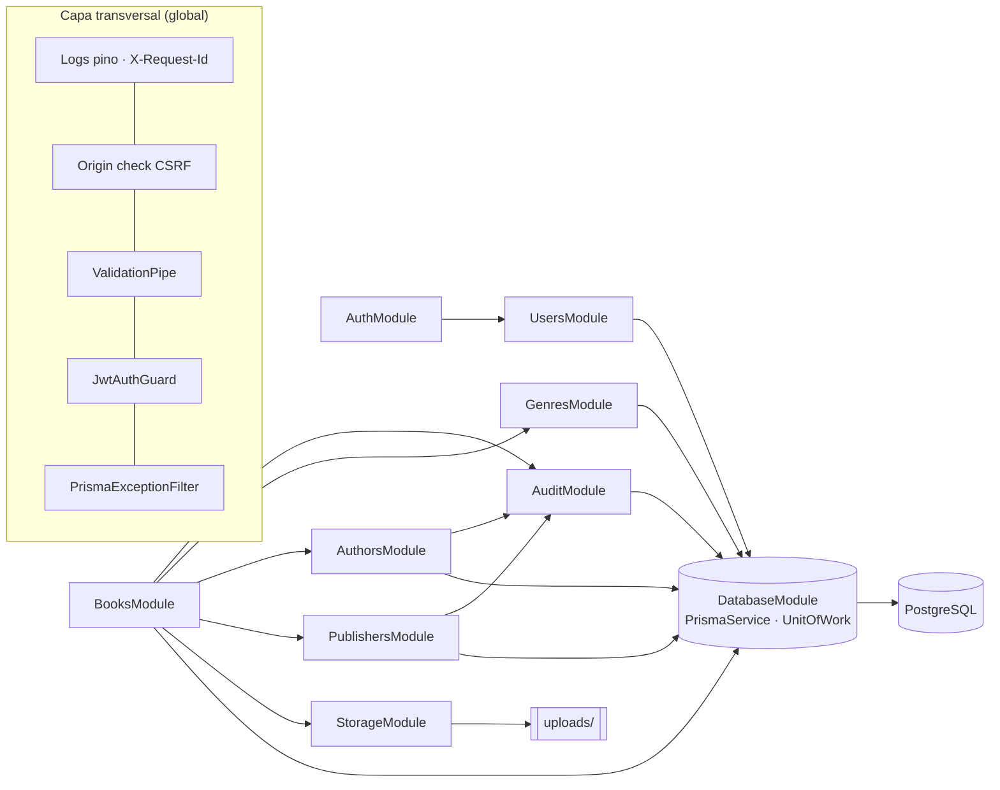
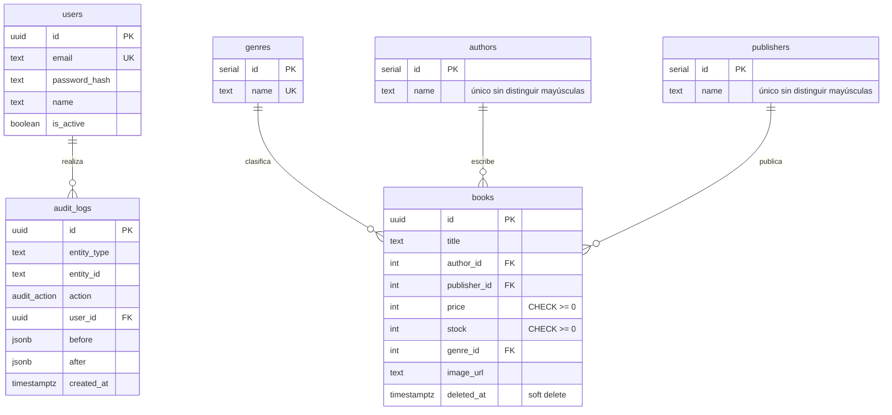

# CMPC Libros: API (backend)

API REST del catálogo de libros de CMPC: **NestJS 12 + TypeScript**, **PostgreSQL 17** con **Prisma ORM 7** y sesión con **JWT (HS256) en una cookie HttpOnly**.

- CRUD de libros con **soft delete**; listado con **filtros, orden multi-campo y paginación**; **exportación CSV** en streaming; **portadas**.
- Catálogos de **autores y editoriales** con búsqueda y alta idempotente («crear al vuelo»).
- **Auditoría transaccional** de cada escritura, consultable con filtros.
- **Límite de intentos de login**, protección **CSRF** y **logs estructurados** con id de petición.
- Documentación **Swagger/OpenAPI** en `/docs`.

La consume la aplicación web del repositorio hermano [`cmpc-libros-frontend`](../cmpc-libros-frontend). Para levantar todo el sistema junto, ver el [README de la carpeta padre](../README.md).

---

## Índice

1. [Puesta en marcha](#1-puesta-en-marcha)
2. [Configuración](#2-configuración)
3. [Uso de la API](#3-uso-de-la-api)
4. [Autenticación y seguridad](#4-autenticación-y-seguridad)
5. [Logs](#5-logs)
6. [Arquitectura](#6-arquitectura)
7. [Modelo de datos](#7-modelo-de-datos)
8. [Decisiones de diseño](#8-decisiones-de-diseño)
9. [Pruebas y cobertura](#9-pruebas-y-cobertura)
10. [Diagramas y estructura](#10-diagramas-y-estructura)

---

## 1. Puesta en marcha

Requisitos: **Node.js 22.12+** (probado con 26), **npm 10+** y **Docker** (para PostgreSQL; también sirve un PostgreSQL 17 propio).

### En modo desarrollo

```bash
npm install                 # postinstall ejecuta `prisma generate`
cp .env.example .env        # y cambia JWT_SECRET (ver la tabla de configuración)
npm run db:up               # sólo PostgreSQL 17 en Docker, publicado en el 5432
npm run db:migrate          # aplica las migraciones
npm run db:seed             # usuario inicial, 10 géneros y 40 libros (idempotente)
npm run start:dev           # API en http://localhost:3000/api · Swagger en http://localhost:3000/docs
```

Usuario de prueba del seed: `admin@cmpc.cl` / `Admin1234!`.

### Con Docker (sólo el backend)

```bash
cp .env.example .env
docker compose up -d --build    # o: npm run docker:up
```

Arranca `postgres` → `migrate` (aplica migraciones y seed, y termina) → `api` en el puerto `API_PORT` (3000). El [`docker-compose.override.yml`](docker-compose.override.yml) se carga solo en este repositorio: fija el nombre del contenedor (`cmpc-libros-postgres`) y publica el 5432 para desarrollar. El [`Dockerfile`](Dockerfile) es multi-etapa: `migrate` (con herramientas de desarrollo) y `runtime` (sólo dependencias de producción, usuario sin privilegios, *healthcheck*).

### Scripts

| Script | Uso |
|---|---|
| `npm run start:dev` / `start:prod` | API en desarrollo (recarga al guardar) / producción (`dist/`) |
| `npm run build` | Compila a `dist/` |
| `npm run lint` / `npm run format` | oxlint con tipos / Prettier |
| `npm test` / `npm run test:cov` | Pruebas unitarias / con cobertura (umbral 80%) |
| `npm run test:e2e` | Pruebas e2e contra la base de desarrollo (no crean datos) |
| `npm run db:up` / `db:down` | Levanta sólo PostgreSQL / detiene los contenedores de este repositorio |
| `npm run docker:up` | PostgreSQL + migraciones/seed + API, todo en Docker |
| `npm run db:migrate` / `db:deploy` / `db:reset` | Migraciones: desarrollo / producción / reinicio con seed (borra los datos) |
| `npm run db:generate` / `db:seed` | Regenera el cliente Prisma / carga los datos iniciales |

> La recarga de `start:dev` vigila el código, **no el `.env`**: después de cambiarlo, reinicia la API.

## 2. Configuración

Todas las variables se validan al arrancar: si alguna falta o es inválida, la API no inicia y dice cuál. Esta tabla es la referencia para todos los modos (desarrollo, Docker del backend y stack completo).

| Variable | Por defecto | Descripción |
|---|---|---|
| `PORT` | `3000` | Puerto en el que escucha la API (dentro del contenedor, siempre 3000) |
| `DATABASE_URL` | — | Conexión a PostgreSQL. En Docker la arma el compose a partir de `POSTGRES_*` |
| `JWT_SECRET` | — | Secreto HS256, mínimo 32 caracteres. Generar uno: `node -e "console.log(require('crypto').randomBytes(48).toString('base64url'))"` |
| `JWT_EXPIRES_IN` | `12h` | Duración del token y, por tanto, de la sesión (`15m`, `12h`, `1d`…) |
| `COOKIE_SECURE` | `false` | `true` hace que la cookie de sesión sólo viaje por HTTPS. Obligatorio fuera de `localhost` |
| `CORS_ORIGINS` | `http://localhost:5173` | Orígenes del frontend, separados por coma. Se usan para CORS **y** para aceptar escrituras (CSRF). En Docker el compose usa `http://localhost:${WEB_PORT},http://localhost:5173` |
| `LOGIN_MAX_ATTEMPTS` / `LOGIN_LOCK_SECONDS` | `5` / `30` | Logins fallidos (mismo email, misma IP) antes del bloqueo, y segundos de bloqueo |
| `NODE_ENV` | `development` | `production` emite logs JSON; cualquier otro valor, logs legibles. La imagen Docker usa `production` |
| `LOG_LEVEL` | `info` | `fatal`, `error`, `warn`, `info`, `debug`, `trace` o `silent` |
| `UPLOADS_DIR` / `UPLOAD_MAX_BYTES` | `uploads` / `2097152` | Carpeta de las portadas y tamaño máximo por imagen (2 MB) |
| `SEED_USER_EMAIL` / `SEED_USER_PASSWORD` / `SEED_USER_NAME` | `admin@cmpc.cl` / `Admin1234!` / `Administrador` | Usuario que crea el seed |
| `POSTGRES_USER` / `POSTGRES_PASSWORD` / `POSTGRES_DB` | `cmpc` / `cmpc` / `cmpc_libros` | Sólo Docker: credenciales del contenedor de PostgreSQL |
| `POSTGRES_PORT` | `5432` | Sólo Docker en este repositorio: puerto publicado de PostgreSQL |
| `API_PORT` / `WEB_PORT` | `3000` / `8080` | Sólo Docker: puerto publicado de la API, y puerto del frontend para armar el CORS por defecto |

## 3. Uso de la API

### Con Swagger

1. Abre `http://localhost:3000/docs`.
2. Ejecuta `POST /api/auth/login` con `{ "email": "admin@cmpc.cl", "password": "Admin1234!" }`.
3. La respuesta fija la cookie de sesión; las peticiones siguientes desde Swagger ya van autenticadas (no hace falta copiar ningún token).

### Endpoints

Prefijo `/api`. Todos exigen sesión (cookie `cmpc_session` o `Authorization: Bearer <token>`) salvo los marcados como públicos.

| Método | Ruta | Descripción |
|---|---|---|
| `POST` | `/auth/login` | **Público.** Fija la cookie de sesión y devuelve `{ expiresAt, user }` (el token no va en el cuerpo). 401 si las credenciales no son válidas, 429 si está bloqueado |
| `POST` | `/auth/logout` | **Público.** Borra la cookie (204) |
| `GET` | `/auth/me` | Sesión actual: `{ expiresAt, user }` |
| `GET` | `/health` | **Público.** Estado de la API |
| `GET` | `/genres` | Catálogo de géneros |
| `GET` | `/authors` · `/publishers` | Búsqueda por nombre (`search`, `limit` ≤ 50) |
| `POST` | `/authors` · `/publishers` | Busca o crea por nombre (`{ "name": "..." }`, sin distinguir mayúsculas): 201 si lo creó (auditado), 200 si ya existía |
| `GET` | `/books` | Listado con filtros, orden y paginación (parámetros abajo) |
| `GET` | `/books/export` | CSV con los mismos filtros y orden |
| `GET` | `/books/:id` | Detalle |
| `POST` | `/books` | Crear (auditado) |
| `PATCH` | `/books/:id` | Actualizar parcialmente (auditado) |
| `DELETE` | `/books/:id` | Soft delete (auditado), 204 |
| `POST` | `/books/:id/image` | Subir o reemplazar la portada: `multipart/form-data`, campo `image`, JPEG/PNG/WebP ≤ 2 MB (auditado) |
| `GET` | `/audit-logs` | Bitácora, más reciente primero. Filtros `entityType`, `entityId`, `userId`, `action`, `from`, `to` (ISO 8601, inclusivos; 400 si `from` > `to`); paginada |
| `GET` | `/uploads/<archivo>` | **Público.** Portadas (estáticas, fuera de `/api`) |

**Parámetros de `GET /books` y `GET /books/export`:**

| Parámetro | Ejemplo | Efecto |
|---|---|---|
| `title`, `author`, `publisher` | `title=cien` | Búsqueda parcial sin distinguir mayúsculas; `author` y `publisher` buscan en el nombre del autor o la editorial |
| `genreId` | `genreId=1` | Filtra por género |
| `available` | `available=true` | `true`: sólo con stock · `false`: sólo sin stock |
| `sort` | `sort=genre:asc,price:desc` | Orden multi-campo por `title, author, publisher, price, stock, genre, createdAt`. Por defecto `createdAt:desc` |
| `page`, `limit` | `page=2&limit=20` | Sólo en el listado; `limit` ≤ 100 |

El listado responde `{ data: Book[], meta: { page, limit, total, totalPages } }`. Los campos de un libro están en inglés: `title`, `author { id, name }`, `publisher { id, name }`, `price` (CLP, entero), `stock` (disponibilidad), `genre { id, name }`, `imageUrl`; al escribir se envían `authorId`, `publisherId` y `genreId`.

**Con curl** (el archivo `cookies.txt` hace de navegador):

```bash
curl -s -c cookies.txt -X POST localhost:3000/api/auth/login -H 'Content-Type: application/json' \
  -d '{"email":"admin@cmpc.cl","password":"Admin1234!"}'
curl -s -b cookies.txt "localhost:3000/api/books?author=garcía&sort=price:desc"
curl -s -b cookies.txt "localhost:3000/api/books/export?genreId=1" -o libros.csv
```

Las **escrituras** con cookie exigen la cabecera `Origin` de un origen permitido (es la protección CSRF). Desde scripts es más simple enviar el token como `Authorization: Bearer <token>` (el token es el valor de `cmpc_session` en `cookies.txt`).

## 4. Autenticación y seguridad

### Sesión

- `POST /auth/login` verifica la contraseña con **bcrypt** (costo 12). Si el email no existe compara igual contra un hash ficticio, para que el tiempo de respuesta no revele qué emails están registrados.
- Firma un **JWT HS256** (`sub`, `email`, `name`, `iat`, `exp`) de **12 h** y lo entrega en la cookie `cmpc_session`:
  - **HttpOnly**: el JavaScript de la página no puede leerla, así que un XSS no puede robar el token;
  - **SameSite=Strict**: el navegador no la envía en peticiones iniciadas desde otros sitios;
  - **`Path=/api`**: no viaja a `/uploads` ni a `/docs`;
  - **cookie de sesión** (sin fecha): se borra al cerrar el navegador; el token igual vence a las 12 h;
  - **`Secure`** según `COOKIE_SECURE`.
- `JwtAuthGuard` (global) acepta el token de la cookie o de `Authorization: Bearer`, y verifica con `algorithms: ['HS256']` fijado (evita la confusión de algoritmo, como `alg: none`). Sólo `login`, `logout`, `health` y `/uploads` son públicos (`@Public()`).
- El secreto exige al menos 32 caracteres (256 bits, RFC 7518 §3.2).

### CSRF

Además de `SameSite=Strict`, un middleware rechaza con **403** las escrituras (`POST`, `PUT`, `PATCH`, `DELETE`) cuyo `Origin` (o, si falta, `Referer`) no sea uno de `CORS_ORIGINS` ni la propia API (Swagger). Una escritura sin ninguna de esas cabeceras sólo pasa si no lleva la cookie (un cliente de API con Bearer).

### Límite de intentos de login

Se cuentan los **logins fallidos por IP + email**. Al quinto fallo (`LOGIN_MAX_ATTEMPTS`) se bloquea esa combinación **30 s** (`LOGIN_LOCK_SECONDS`): la API responde **429** con la cabecera `Retry-After` y no verifica la contraseña mientras dure. Un login correcto reinicia el contador, y los fallos se olvidan tras 15 minutos sin intentos.

- Contar por IP + email evita que alguien bloquee a otro usuario desde otra red, y que usuarios detrás de una misma IP se bloqueen entre sí.
- El contador vive en la memoria del proceso (`InMemoryLoginThrottle`, detrás del contrato `LoginThrottle`). Con varias réplicas de la API habría que compartirlo, por ejemplo en Redis, sin tocar el servicio.
- Detrás de un proxy inverso hay que configurar `trust proxy` en Express para que la IP sea la del cliente y no la del proxy.

### HS256 frente a RS256

| Aspecto | HS256 (simétrico) | RS256 (asimétrico) |
|---|---|---|
| Claves | Un secreto compartido firma **y** verifica | La clave **privada** firma; la **pública** sólo verifica |
| Quién puede emitir tokens | Cualquiera que pueda verificarlos | Sólo quien tiene la clave privada |
| Escenario ideal | Un único servicio que emite y valida (este caso) | Varios servicios, gateways o terceros que validan sin poder emitir |
| Tamaño de la firma | 32 bytes | 256 bytes con RSA-2048 (el token crece unos 300 caracteres) |
| Rotación | Rotar el secreto invalida todos los tokens a la vez | Gradual con `kid` + JWKS |

**Cambios para adoptar RS256:**

1. Generar un par RSA de al menos 2048 bits: `openssl genpkey -algorithm RSA -pkeyopt rsa_keygen_bits:3072 -out private.pem` y `openssl pkey -in private.pem -pubout -out public.pem`.
2. Reemplazar `JWT_SECRET` por `JWT_PRIVATE_KEY` y `JWT_PUBLIC_KEY` (PEM). En `AuthModule`: `privateKey`/`publicKey`, `signOptions.algorithm: 'RS256'` y `verifyOptions.algorithms: ['RS256']`. El guard no cambia.
3. Mantener fijado `algorithms: ['RS256']` al verificar: evita firmar con HS256 usando la clave pública como secreto.
4. Guardar la clave privada en un gestor de secretos o KMS, nunca en el repositorio ni en la imagen.
5. Incluir `kid` en el token y publicar las claves vigentes en `GET /.well-known/jwks.json` para rotar sin cortes.
6. Alternativa: **ES256 o EdDSA**, con la misma separación de claves y firmas de 64 bytes.

**Recomendación:** mantener HS256 mientras la API sea el único emisor y verificador; pasar a RS256 (o ES256) cuando otro servicio deba validar tokens.

### Pendientes recomendados

| Recomendación | Motivo |
|---|---|
| Access token corto (5–15 min) + **refresh token** rotativo, guardado como hash con revocación | Acorta la vida de un token robado y permite cerrar sesiones desde el servidor |
| **Revocación**: comprobar `is_active` o un `token_version` por usuario en el guard | Hoy un usuario desactivado conserva su token hasta que vence |
| Validar `iss` y `aud` | No aceptar tokens emitidos para otro sistema |
| **HTTPS + HSTS + `helmet`**, y `COOKIE_SECURE=true` | Protege la cookie en tránsito y añade cabeceras de seguridad |
| **Content-Security-Policy** en el frontend | Reduce el impacto de un XSS (que ya no puede leer el token, pero sí actuar en la página) |
| Política de contraseñas y **MFA** para cuentas administrativas | Defensa en profundidad |
| Secretos en un gestor de secretos con rotación | `.env` sólo para desarrollo |

## 5. Logs

Los logs son de **pino** (vía `nestjs-pino`):

- **Una línea por petición** con método, ruta, estado, duración, **id de petición** y usuario autenticado. El nivel depende del resultado: `info` (2xx/3xx), `warn` (4xx), `error` (5xx o excepción, con stack).
- **Id de petición:** se toma de la cabecera `X-Request-Id` si llega (desde un proxy o el cliente) o se genera uno, y se devuelve en la respuesta. Todos los logs emitidos durante esa petición lo incluyen (`requestId`), así se sigue una operación de punta a punta.
- **Eventos con contexto:** `Login correcto`, `Login fallido` (email enmascarado, `a***@cmpc.cl`, e IP), `Login bloqueado`, cada escritura auditada (`Auditoría: UPDATE Book <id>` con el usuario) y los errores.
- **Datos sensibles ocultos:** `Authorization`, cookies, `Set-Cookie`, contraseñas y tokens se reemplazan por `[oculto]`.
- **Formato:** JSON en producción (`NODE_ENV=production`, uno por línea, listo para un agregador como Loki, ELK o CloudWatch) y legible con colores en desarrollo.
- El healthcheck (`/api/health`) no se registra: Docker lo consulta cada 10 s.

Ejemplo en producción:

```json
{"level":40,"time":1795095075900,"requestId":"demo-logs-1","context":"AuthService","email":"n***@cmpc.cl","ip":"::1","msg":"Login fallido"}
{"level":40,"time":1795095075901,"requestId":"demo-logs-1","req":{"method":"POST","url":"/api/auth/login","ip":"::1"},"res":{"statusCode":401},"responseTime":313,"msg":"POST /api/auth/login 401 313ms"}
```

## 6. Arquitectura

Módulos por funcionalidad, cada uno con las mismas cuatro capas y dependencias que apuntan hacia el dominio:

```
http/            controladores + DTOs (class-validator, decoradores Swagger)
  └─▶ application/   servicios: reglas de negocio, orquestación, transacciones
        └─▶ domain/      tipos y contratos abstractos (BooksRepository, UnitOfWork, LoginThrottle…)
              ▲
infrastructure/  implementaciones (Prisma, bcrypt, memoria, disco)
```



| Módulo | Responsabilidad |
|---|---|
| `config` | Variables de entorno tipadas y validadas al arrancar |
| `logging` | Configuración de pino: id de petición, niveles, ocultación de datos sensibles |
| `database` (global) | `PrismaService`, `UnitOfWork` (transacciones) y filtro de errores de Prisma |
| `auth` | Login, cookie de sesión, límite de intentos, guard global y `PasswordHasher` (bcrypt) |
| `users` | Repositorio de usuarios |
| `genres` | Catálogo de géneros |
| `authors`, `publishers` | Búsqueda y alta idempotente con auditoría; comparten `common/catalog` |
| `books` | CRUD, soft delete, listado, exportación CSV e imagen |
| `audit` | `AuditService.record()` reutilizable y consulta de la bitácora |
| `storage` | `ImageStorage` (contrato) con implementación en disco local |
| `common/http` | Prefijo de la API y protección CSRF por `Origin` |

### SOLID

- **Responsabilidad única:** el controlador traduce HTTP ↔ dominio (y gestiona la cookie), el servicio aplica las reglas, el repositorio persiste, `BooksCsvSerializer` da formato al CSV e `ImageStorage` guarda archivos.
- **Abierto/cerrado:** auditar otra entidad no toca `AuditService` (`entityType` es genérico); pasar las portadas a S3 o el contador de logins a Redis es una nueva implementación de `ImageStorage` o `LoginThrottle`.
- **Sustitución de Liskov:** cualquier implementación de `BooksRepository`, `ImageStorage`, `PasswordHasher` o `LoginThrottle` sirve sin cambiar los servicios; los tests usan dobles.
- **Segregación de interfaces:** contratos pequeños; `AuditService.record` sólo pide `Pick<TransactionContext, 'auditLogs'>`.
- **Inversión de dependencias:** los servicios dependen de clases abstractas usadas como tokens de DI, nunca de Prisma.

### Transacciones y auditoría

Cada escritura y su registro de auditoría se confirman o se revierten juntos:

```ts
return this.unitOfWork.run(async (ctx) => {          // BEGIN
  const before = await ctx.books.findActiveById(id)  // repositorios ligados a la transacción
  const after = await ctx.books.update(id, data)
  await this.audit.record(ctx, { entityType: 'Book', entityId: id, action: 'UPDATE', userId, before, after })
  return after
})                                                    // COMMIT (o ROLLBACK si algo lanza)
```

En la carga de imágenes el archivo se escribe **antes** de la transacción: si la transacción falla se borra el nuevo, y si se confirma se borra el anterior. No quedan archivos huérfanos ni referencias rotas.

### Otros detalles

- **Alta idempotente de catálogos:** `INSERT … ON CONFLICT (lower(name)) DO NOTHING`; peticiones simultáneas con el mismo nombre reciben el mismo registro.
- **Validación estricta:** `whitelist` + `forbidNonWhitelisted` (se rechazan campos desconocidos) y mensajes en español.
- **Errores de Prisma** traducidos a 404/409/400 sin exponer detalles internos.
- **CSV:** streaming con cursor (lotes de 500, memoria constante), RFC 4180, BOM UTF-8 para Excel y neutralización de fórmulas (`=`, `+`, `-`, `@`).
- **Imágenes:** tipo validado por *magic numbers*, tamaño limitado (413), nombre generado por el servidor (UUID) y borrado sin *path traversal*.

## 7. Modelo de datos



| Tabla | Por qué existe |
|---|---|
| `users` | Credenciales (hash bcrypt) y autor real de cada operación auditada. `is_active` revoca el acceso sin borrar historia |
| `genres` | Conjunto cerrado: evita variantes ("Ficción" / "ficcion"), alimenta el selector y filtra por FK entera |
| `authors`, `publishers` | Un autor o editorial aparece en varios libros: normalizarlo evita duplicados y permite renombrar en un solo lugar. Nombre único sin distinguir mayúsculas. Un libro tiene un autor y una editorial |
| `books` | Entidad principal; referencias con `ON DELETE RESTRICT`, `price` y `stock` enteros con `CHECK >= 0` |
| `audit_logs` | Bitácora genérica (`entity_type` + `entity_id`) con instantáneas `before`/`after` en JSONB |

**`audit_logs` no tiene FK hacia `books`:** la bitácora sirve para cualquier tabla, y una FK la ataría a una sola. Se compensa con el soft delete (los libros nunca se borran físicamente) y con la inserción en la misma transacción. Sí tiene FK hacia `users`. Tampoco hay relación `users`–`books`: no existe "dueño" de un libro; la relación es histórica y vive en la auditoría.

**Normalización:** todas las tablas están en forma normal de Boyce-Codd. Las instantáneas JSON de la auditoría son una desnormalización deliberada (el historial debe quedar como estaba aunque luego cambien los datos).

**Índices y la consulta que sirve cada uno:**

| Índice | Consulta |
|---|---|
| GIN `gin_trgm_ops` en `books.title`, `authors.name`, `publishers.name` | Filtros `ILIKE '%texto%'` (un B-tree no sirve con comodín inicial) |
| `books (author_id, deleted_at)`, `(publisher_id, deleted_at)`, `(genre_id, deleted_at)` | Filtros por autor, editorial y género sobre libros activos; indexan las FKs |
| `books (deleted_at, stock)` | Filtro de disponibilidad |
| `books (deleted_at, created_at DESC)` | Orden por defecto del listado |
| `audit_logs (entity_type, entity_id, created_at DESC)` · `(user_id, created_at DESC)` · `(created_at DESC)` | Historial de una entidad, actividad de un usuario y bitácora cronológica (con rango de fechas) |
| UNIQUE en `users.email`, `genres.name`, `lower(authors.name)`, `lower(publishers.name)` | Login y unicidad; los dos últimos sostienen el alta idempotente |

El orden multi-campo agrega `id` como desempate final, así la paginación es determinista.

## 8. Decisiones de diseño

| Decisión | Alternativas | Motivo |
|---|---|---|
| Repositorio + UnitOfWork | Prisma directo en los servicios | Servicios testeables y transacción expresada en el dominio |
| Auditoría con `AuditService.record(ctx)` dentro de la transacción | Interceptor HTTP · extensión de Prisma | Atomicidad garantizada y explícita |
| Guard JWT global + `@Public()` | `@UseGuards` por controlador | Un endpoint nuevo nunca queda abierto por olvido |
| JWT en cookie HttpOnly + SameSite=Strict + verificación de `Origin`; se sigue aceptando Bearer | Token en el cuerpo y `sessionStorage` · cookie con token CSRF de doble envío | El token queda fuera del alcance de JavaScript; CSRF cubierto sin tokens extra porque frontend y API son del mismo sitio. Bearer mantiene Swagger y los clientes de API |
| Cookie de sesión (sin fecha) y token de 12 h | Cookie persistente de 12 h | La sesión no sobrevive a cerrar el navegador (equipos compartidos) |
| Límite de login por IP + email, sólo fallos, en memoria | `@nestjs/throttler` por IP · bloqueo por cuenta | No castiga a usuarios que comparten IP ni permite bloquear la cuenta de otro |
| Logs con `nestjs-pino` | Logger nativo de Nest en JSON | Estructurados, id de petición y ocultación de datos sin código propio |
| `@nestjs/jwt` + guard propio | Passport | Menos indirección; algoritmo fijado explícitamente |
| `class-validator` | Zod | Integración directa con Swagger y el `ValidationPipe` |
| bcrypt (costo 12) | argon2 | Elección confirmada; unos 250 ms por hash |
| Autores y editoriales como tablas, un autor por libro | Texto libre · N:M | Integridad sin complicar listado, orden, CSV ni el esquema pedido |
| Gestión mínima de catálogos (sin editar ni eliminar) | CRUD completo | Alcance acotado; `ON DELETE RESTRICT` protege lo que está en uso |
| Imagen en endpoint propio, en disco local tras `ImageStorage` | Multipart en el CRUD · S3 | Sin archivos huérfanos, CRUD en JSON y migración a S3 sin tocar servicios |
| Nombres en inglés en código y API | Español | Convención estándar; la interfaz se muestra en español |

## 9. Pruebas y cobertura

```bash
npm test            # unitarias
npm run test:cov    # con cobertura (umbral 80% en sentencias, ramas, funciones y líneas)
npm run test:e2e    # requiere la base levantada, migrada y con seed; no crea datos
```

- **181 pruebas unitarias** en 24 archivos, un `*.spec.ts` junto a cada servicio, controlador, repositorio y pieza de infraestructura (límite de login, verificación de origen, configuración de logs).
- **18 pruebas e2e** (supertest) contra la API completa y la base: cookie de sesión (HttpOnly, SameSite, sin token en el cuerpo), `/auth/me`, cierre de sesión, rechazo CSRF, bloqueo tras 5 fallos con `Retry-After`, `X-Request-Id`, filtros, orden, validación, CSV, catálogos y auditoría con rango de fechas.
- **Cobertura:** 98,5% sentencias · 92,4% ramas · 97,0% funciones · 98,4% líneas. Se excluyen los archivos sin lógica (módulos de DI, contratos abstractos, `main.ts`, cliente generado).