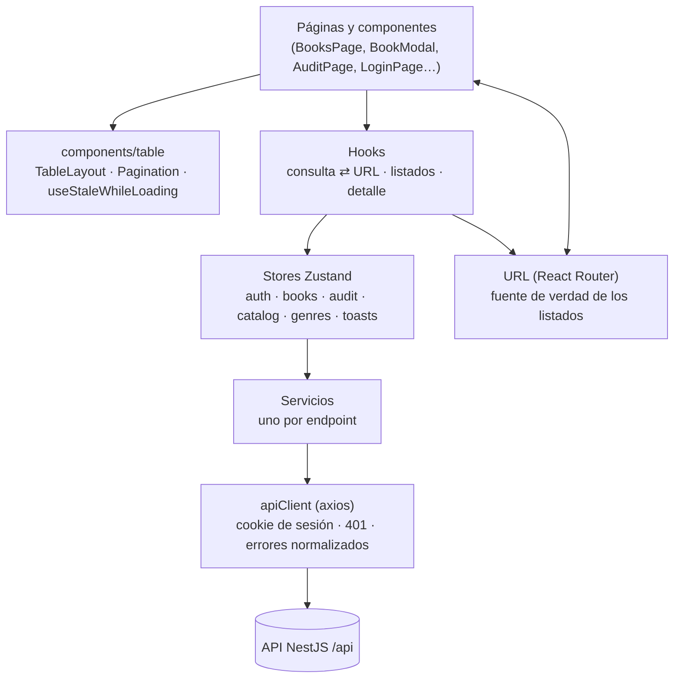

# CMPC Libros: aplicación web (frontend)

Aplicación web (SPA) para consultar y gestionar el catálogo de libros de CMPC: **React 19 + TypeScript + Vite**, **Zustand** para el estado y la caché, **React Router** y **Tailwind CSS** con componentes propios.

- Inicio de sesión con **cookie de sesión HttpOnly** (el JavaScript nunca ve el token) y cuenta atrás si el login se bloquea.
- **Catálogo** con filtros en tiempo real, orden multi-columna, paginación del servidor y **exportación CSV**.
- **Formulario** de creación y edición con validación inmediata, combobox de autor y editorial con **crear al vuelo** y carga de portada.
- **Auditoría**: quién creó, editó o eliminó qué, con el detalle antes → después.

Consume la API del repositorio hermano [`cmpc-libros-backend`](../cmpc-libros-backend), cuyo README documenta los endpoints. Para levantar todo el sistema junto, ver el [README de la carpeta padre](../README.md).

---

## Índice

1. [Puesta en marcha](#1-puesta-en-marcha)
2. [Guía de uso](#2-guía-de-uso)
3. [Arquitectura](#3-arquitectura)
4. [Estado, caché y rendimiento](#4-estado-caché-y-rendimiento)
5. [Decisiones de diseño](#5-decisiones-de-diseño)
6. [Diseño visual y accesibilidad](#6-diseño-visual-y-accesibilidad)
7. [Pruebas y cobertura](#7-pruebas-y-cobertura)
8. [Estructura del proyecto](#8-estructura-del-proyecto)

---

## 1. Puesta en marcha

Requisitos: **Node.js 22.12+** (probado con 26), **npm 10+** y la API en ejecución (por defecto en `http://localhost:3000`).

### En modo desarrollo

```bash
npm install
cp .env.example .env.local     # sólo si la API no está en http://localhost:3000
npm run dev                    # http://localhost:5173
```

| Variable | Por defecto | Descripción |
|---|---|---|
| `VITE_API_URL` | `http://localhost:3000` | URL de la API, **sin** `/api`. También se usa para las portadas (`/uploads/...`) |

La API debe aceptar el origen `http://localhost:5173` (lo hace por defecto) y estar en el **mismo sitio** que la web: la cookie de sesión es `SameSite=Strict`, así que `localhost` con `localhost` funciona, pero `localhost` con `127.0.0.1` no.

### Con Docker (sólo el frontend)

```bash
docker compose up -d --build     # http://localhost:8080
```

Compila con Vite y sirve con nginx ([`Dockerfile`](Dockerfile), configuración en [`nginx/`](nginx/)). Variables opcionales en un `.env` (ver [`.env.example`](.env.example)):

| Variable | Por defecto | Descripción |
|---|---|---|
| `WEB_PORT` | `8080` | Puerto de la web en tu máquina |
| `PUBLIC_API_URL` | `http://localhost:${API_PORT}` | URL de la API tal como la ve el navegador. **Se fija al compilar**: si cambia, reconstruye con `--build` |
| `API_PORT` | `3000` | Sólo se usa para armar `PUBLIC_API_URL` si no la defines |

### Scripts

| Script | Uso |
|---|---|
| `npm run dev` | Servidor de desarrollo con recarga en caliente |
| `npm run build` / `npm run preview` | Chequeo de tipos + build de producción en `dist/` / servirlo |
| `npm run lint` | ESLint (reglas de React Hooks y React Compiler) |
| `npm run format` / `format:check` | Prettier: formatea / sólo revisa |
| `npm test` / `npm run test:cov` | Pruebas / con cobertura (umbral 80%) |

Para publicar sin Docker, `dist/` sirve en cualquier hosting estático siempre que todas las rutas respondan con `index.html` (es una SPA).

## 2. Guía de uso

1. **Ingresar.** Usuario de prueba del seed: `admin@cmpc.cl` / `Admin1234!`.
   - La sesión dura **12 h** y se mantiene al recargar o abrir otra pestaña; termina al vencer, con **Salir** o al cerrar el navegador.
   - Si vence, el login lo avisa y luego te devuelve a donde estabas.
   - Tras **5 intentos fallidos** con el mismo email, el formulario se bloquea **30 s** con una cuenta atrás.
2. **Buscar.** En **Catálogo**, escribe en Título, Autor o Editorial (se aplica al dejar de escribir), elige un **Género** o activa **Sólo con stock**. Los filtros activos se marcan con línea punteada y **Limpiar filtros** los quita. En el celular, el resto de filtros está en **Más filtros**.
3. **Ordenar.** Cada clic en un encabezado alterna ascendente, descendente y sin orden. Se puede ordenar por **varias columnas** (el número indica la prioridad); **Quitar orden** lo limpia sin tocar los filtros.
4. **Paginar.** 10, 20 o 50 por página. La tabla siempre ocupa el alto de una página completa, así nada se mueve al filtrar.
5. **Compartir una vista.** Filtros, orden y página viven en la URL: recargar o enviar el enlace abre la misma vista.
6. **Ver el detalle.** El ojo o el título abren el detalle en un modal sobre el catálogo; Esc, la X, un clic fuera o Atrás lo cierran. Desde ahí se puede **Editar** o **Eliminar**.
7. **Crear o editar.** **Nuevo libro** o el lápiz abren el formulario en el mismo tipo de modal, con la distribución del detalle: portada a la izquierda y cada campo con su etiqueta a la izquierda (en el celular, los campos primero y la portada al final). **Editar** desde el detalle transforma ese mismo modal en el formulario.
   - Los campos se validan al escribir y el pie resume lo que falta.
   - Al guardar o cancelar se vuelve a donde se abrió: al detalle si fue desde ahí, si no al catálogo (que conserva sus filtros y se actualiza solo).
   - Si hay cambios sin guardar (incluida una portada elegida), cerrar de cualquier forma (Cancelar, Esc, la X, un clic fuera o Atrás) pide confirmar **¿Descartar los cambios?**; recargar o cerrar la pestaña muestra el aviso del navegador.
   - **Autor y editorial** se eligen en un combobox: si el nombre no existe, la última opción es **Crear el autor «…»**. Con teclado: ↑/↓, Enter y Esc. Al salir del campo sin elegir, el texto vuelve a la selección anterior.
   - La portada se arrastra o se elige (JPG, PNG o WebP, hasta 2 MB) con vista previa.
8. **Eliminar.** Papelera y confirmación. El libro desaparece del catálogo, pero se conserva (borrado lógico) y queda en la auditoría.
9. **Auditoría.** La pestaña junto a Catálogo lista las operaciones, la más reciente primero. Filtra por **Acción**, **Entidad** y **Desde / Hasta** (días completos en tu hora local). La columna **Cambios** resume lo ocurrido y el ojo abre la tabla **Campo / Antes / Después** (en una creación o eliminación, el registro completo).
10. **Exportar.** **Exportar CSV** descarga `CMPC-LIBROS-<timestamp>.csv` con todos los libros que cumplen los filtros y el orden activos.

## 3. Arquitectura

Código organizado por funcionalidad, con dependencias en una sola dirección:



| Capa | Responsabilidad | Ejemplo |
|---|---|---|
| Páginas / componentes | Presentación; leen el estado con selectores | `BooksPage`, `BookFilters` |
| `components/table` | Marco común de los listados (ver abajo) | `TableLayout`, `Pagination` |
| Hooks | Conectan componentes con la URL y los stores | `useBookListQuery`, `useAuditList` |
| Stores | Estado global, caché y mutaciones | `useBooksStore.fetchList` |
| Servicios | Una función por endpoint; lanzan `ApiError` | `booksService.list(query, signal)` |
| Cliente HTTP | axios con `withCredentials` (envía la cookie); un 401 cierra la sesión | `apiClient` |

**`TableLayout`** es el marco de las dos tablas (catálogo y auditoría): sección de resultados, encabezado, ancho fijo de columnas desde 1024 px, filas esqueleto, filas en blanco hasta completar la página, barra de actualización, resultado anterior atenuado, mensaje centrado (vacío o error), aviso de error al refrescar y pie de paginación. Cada tabla sólo aporta sus columnas, su encabezado y sus filas. `useStaleWhileLoading` decide qué resultado mostrar mientras llega el nuevo.

**Rutas:** `/login`, `/books` (catálogo), `/books/:id` (detalle), `/books/new` y `/books/:id/edit` (formulario) y `/audit`. Las tres de un libro son modales sobre el catálogo y usan el mismo componente (`BookModal`), por eso pasar del detalle a editar no cierra el modal; el catálogo sigue montado detrás y se refresca cuando una escritura vence su caché. Todas salvo `/login` pasan por `AppShell`, que espera a confirmar la sesión, redirige al login recordando el destino y dibuja la cabecera con las pestañas. Cada ruta se carga **bajo demanda**.

## 4. Estado, caché y rendimiento

| Store | Contenido |
|---|---|
| `auth.store` | Estado de la sesión (`checking` → `authenticated` / `anonymous`), usuario, expiración y bloqueo del login. **No guarda el token**: al abrir la app pregunta a `GET /auth/me` si la cookie sigue vigente. Programa el cierre al vencer |
| `books.store` | Listados por consulta (filtros + orden + página) y detalles por id; mutaciones y exportación |
| `audit.store` | Listados de auditoría por consulta, **sin TTL**: siempre se revalida (la bitácora cambia con cada operación) |
| `catalog.store` | Búsquedas de autores y editoriales y alta «crear al vuelo» |
| `genres.store` | Géneros, una vez por sesión |
| `toast.store` | Notificaciones |

**Caché de llamadas reiteradas:**

- **TTL de 60 s** (catálogo y combobox): volver a una consulta reciente responde sin red.
- **Stale-while-revalidate:** lo vencido se sigue mostrando mientras se refresca.
- **Deduplicación** de peticiones iguales simultáneas y **cancelación** de la anterior al cambiar la búsqueda.
- **Invalidación:** crear, editar o subir una imagen vence los listados; eliminar quita el libro al instante; cerrar sesión descarta toda la caché.

**Estabilidad visual:** columnas de ancho fijo y filas de 60 px, alto de tabla constante, resultado anterior atenuado en lugar de vaciar la tabla, barra bajo los filtros con altura reservada y `scrollbar-gutter: stable` (la cabecera no se mueve al pasar de una pantalla con scroll a otra sin él). Medido en un navegador real: desplazamiento de diseño acumulado (CLS) de 0.

**Renderizado:** selectores de Zustand, formularios no controlados (React Hook Form), filas memoizadas, debounce de 350 ms y code-splitting por ruta (bundle inicial de 229 kB, 73 kB gzip).

## 5. Decisiones de diseño

| Decisión | Alternativas | Motivo |
|---|---|---|
| Sesión en cookie HttpOnly gestionada por el backend; el frontend sólo conoce usuario y expiración | JWT en `sessionStorage` (versión anterior) · `localStorage` | Un XSS no puede leer el token. Al no haber nada guardado, la sesión se restaura con `/auth/me` |
| `TableLayout` común para todas las tablas | Una implementación por tabla | La estabilidad visual se resuelve una vez y cualquier tabla nueva la hereda |
| Tailwind CSS 4 + componentes propios | CSS Modules · MUI | Control total del diseño y CSS mínimo |
| URL como fuente de verdad de los listados | Estado sólo en Zustand | Recargar mantiene la vista, el enlace se comparte y Atrás funciona |
| Detalle y formulario del libro como rutas que abren un modal sobre el catálogo; detalle de auditoría como estado local | Formulario en pantalla propia · modal sin URL | Se pueden enlazar y recargar, Atrás los cierra y el catálogo no se pierde de vista; la API no expone un registro de auditoría por id |
| Formulario con la distribución del detalle, en el mismo modal | Formulario en una sola columna | Se reconoce como la misma ficha, ahora editable; editar desde el detalle no cierra ni reabre nada |
| Confirmar antes de descartar cambios (bloqueo de navegación del router) | Cerrar sin preguntar | En un modal es fácil cerrar sin querer (Esc, clic fuera); el bloqueo cubre también Atrás |
| Lista del combobox con `position: fixed` junto al campo | `absolute` dentro del campo | Un `<dialog>` y su cuerpo con scroll recortan a sus hijos `absolute`; fija, la lista se ve entera y se abre hacia arriba si no cabe |
| React Hook Form + Zod | Validación manual | Menos re-renders; el esquema refleja los DTO del backend |
| Combobox propio con crear al vuelo (ARIA 1.2) | Texto libre · pantallas de gestión | Evita duplicados con una sola pantalla |
| axios | fetch con wrapper | Interceptores y cancelación listos |
| `<dialog>` nativo | Modal a mano | Foco atrapado, Esc y fondo inerte del navegador |
| Imagen subida después de guardar el libro | Un solo multipart | Si la imagen falla, el libro queda guardado y se informa aparte |
| Prettier con el estilo del proyecto (sin `;`, comillas simples, 120 columnas) + `eslint-config-prettier` | Estilo del backend | Formato automático sin reescribir el estilo existente |
| Vitest + Testing Library + MSW | `vi.mock` de axios | Las pruebas recorren axios y las peticiones reales, interceptadas en la red |

## 6. Diseño visual y accesibilidad

Dirección **«Cartulina y tinta»** (elegida con la skill *impeccable*): barra kraft como marco, zona de trabajo de cartulina blanca, tinta negra, verde flexo sólo para la acción principal y rojo/ámbar sólo para estados. Tipografía única **Archivo** de ancho variable. La **línea de troquel** (punteada) marca todo lo activo: filtros con valor, página actual, zona de carga y foco de teclado. El sistema completo está en [`DESIGN.md`](DESIGN.md) y el contexto de producto en [`PRODUCT.md`](PRODUCT.md).

**Accesibilidad (objetivo WCAG 2.2 AA):** contraste ≥ 4,5:1; campos con etiqueta y errores anunciados; tablas con `caption` y `aria-sort`; combobox con roles ARIA y teclado; paginación con `aria-current`; notificaciones en `aria-live`; navegación completa por teclado.

**Movimiento:** transiciones breves con curva de salida (entrada de filas en cascada, cambio de pantalla, paneles y avisos), todas desactivadas con `prefers-reduced-motion`.

**Responsive:** bajo 1024 px las tablas pasan a tarjetas, los encabezados de orden a chips y los filtros secundarios se pliegan. Probado a 1440, 1024 y 390 px.

## 7. Pruebas y cobertura

```bash
npm test
npm run test:cov    # umbral de 80% en sentencias, ramas, funciones y líneas
```

- **195 pruebas** en 17 archivos. MSW simula la API en la red (`src/test/server.ts`) y las páginas se prueban con el router real (`renderApp`).
- **Lógica:** cliente HTTP (cookie con credenciales, 401, 429 con `Retry-After`), errores, URL ⇄ consulta, orden multi-campo, esquema Zod, caché (TTL, deduplicación, cancelación, invalidación), sesión (restaurar con `/auth/me`, expiración, cierre con el backend, bloqueo del login) y diff de auditoría.
- **Pantallas:** login (validación, credenciales, bloqueo con cuenta atrás, espera de la sesión), catálogo (debounce, filtros, orden, paginación, estabilidad visual de `TableLayout`, exportación, eliminación), combobox (incluida su posición fija dentro del modal), formulario en modal (creación con imagen, errores, edición desde el detalle en el mismo modal, vuelta al origen, confirmación al descartar, foco inicial) y auditoría (pestaña, filtros con fechas locales, detalle, estados vacío y de error).
- **Cobertura:** 98,1% sentencias · 96,7% ramas · 95,8% funciones · 98,6% líneas.

## 8. Estructura del proyecto

```
src/
├── app/               rutas (lazy), AppShell (sesión + cabecera), NotFound, RouteFallback
├── components/
│   ├── table/         TableLayout, Pagination, useStaleWhileLoading, paging (tamaños y ventana de páginas)
│   └── ui/            Button, TextField/SelectField, Toggle, Modal, Toaster, States, Spinner
├── config/env.ts      URL de la API
├── lib/               http/ (axios + ApiError), cache, format, download
├── features/
│   ├── auth/          servicio, store de sesión, LoginPage
│   ├── books/         tipos, query, esquema Zod, servicios, stores, hooks, components/ (tabla, filtros,
│   │                  BookModal: detalle + formulario BookEditor, combobox…), pages/BooksPage
│   ├── audit/         tipos, query, describe (diff), servicio, store, hooks, components/, pages/
│   └── notifications/ store de notificaciones
├── test/              setup, handlers MSW, fixtures, renderApp
└── index.css          tokens de diseño (Tailwind @theme)
docs/arquitectura.drawio   diagrama de arquitectura (abrir en draw.io)
DESIGN.md · PRODUCT.md     sistema de diseño y contexto de producto
```
